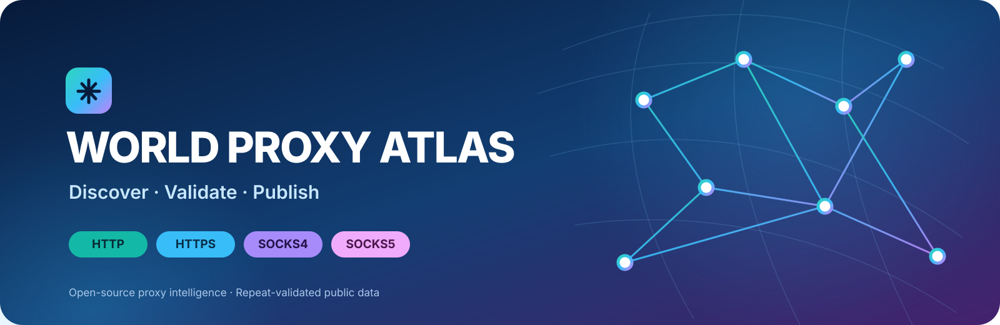
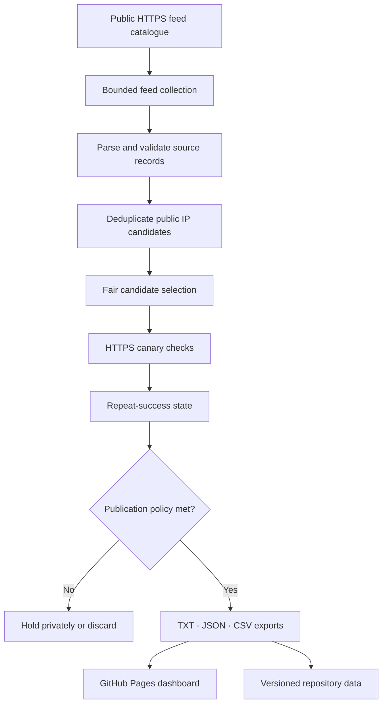

<div align="center">
  
</div>

<div align="center">

# 🌍 World Proxy Atlas

### Free public proxy list · Live proxy checker · HTTP, HTTPS, SOCKS4 & SOCKS5

**Discover broadly. Validate independently. Publish selectively.**

[](https://marianalejandro89-design.github.io/world-proxy-atlas/)
[](https://github.com/marianalejandro89-design/world-proxy-atlas/actions/workflows/refresh-and-pages.yml)
[](https://github.com/marianalejandro89-design/world-proxy-atlas/actions/workflows/ci.yml)

[](https://github.com/marianalejandro89-design/world-proxy-atlas/stargazers)
[](https://github.com/marianalejandro89-design/world-proxy-atlas/network/members)
[](LICENSE)
[](https://www.python.org/)
[](#-proxy-protocols)

**[Open the live proxy dashboard](https://marianalejandro89-design.github.io/world-proxy-atlas/) · [Download all proxies](https://raw.githubusercontent.com/marianalejandro89-design/world-proxy-atlas/main/proxies/all.txt) · [Explore source code](https://github.com/marianalejandro89-design/world-proxy-atlas)**

</div>

---

## ✨ What is World Proxy Atlas?

**World Proxy Atlas** is an open-source **free proxy list, proxy scraper and automated proxy checker**. It discovers public proxy candidates from a multi-publisher catalogue, tests them through real HTTPS destinations, tracks repeat observations and publishes only endpoints that meet explicit quality rules.

Instead of presenting every scraped IP address as a working proxy, the Atlas separates discovery from verification. A feed entry is only a candidate: it must pass the Atlas validation process before it can appear in the public downloads.

The project continuously builds machine-readable **HTTP proxy lists, HTTPS-to-proxy lists, SOCKS4 proxy lists and SOCKS5 proxy lists**, together with JSON, CSV and source-performance data.

<div align="center">

| 🔎 Discover | 🧪 Validate | 🏅 Qualify | 📦 Publish |
|:---:|:---:|:---:|:---:|
| Public feeds | Real HTTPS checks | Repeat-success policy | TXT · JSON · CSV |

</div>

## 🚀 Live data and downloads

The dashboard and downloadable files are generated from the same quality-gated snapshot.

| Resource | What it contains |
|---|---|
| **[🌐 Live dashboard](https://marianalejandro89-design.github.io/world-proxy-atlas/)** | Search, filter, inspect and export currently qualified proxies |
| **[All proxies](https://raw.githubusercontent.com/marianalejandro89-design/world-proxy-atlas/main/proxies/all.txt)** | Every published endpoint with its protocol scheme |
| **[HTTP proxy list](https://raw.githubusercontent.com/marianalejandro89-design/world-proxy-atlas/main/proxies/http.txt)** | Qualified HTTP proxy addresses |
| **[HTTPS proxy transport](https://raw.githubusercontent.com/marianalejandro89-design/world-proxy-atlas/main/proxies/https.txt)** | Proxies that use TLS between the client and proxy |
| **[SOCKS4 proxy list](https://raw.githubusercontent.com/marianalejandro89-design/world-proxy-atlas/main/proxies/socks4.txt)** | Qualified SOCKS4 endpoints |
| **[SOCKS5 proxy list](https://raw.githubusercontent.com/marianalejandro89-design/world-proxy-atlas/main/proxies/socks5.txt)** | Qualified SOCKS5 endpoints |
| **[HTTP CONNECT list](https://raw.githubusercontent.com/marianalejandro89-design/world-proxy-atlas/main/proxies/http-connect.txt)** | HTTP proxies that successfully tunnel HTTPS requests |
| **[Strong tier](https://raw.githubusercontent.com/marianalejandro89-design/world-proxy-atlas/main/proxies/strong.txt)** | Faster endpoints with a longer successful-check history |
| **[JSON dataset](https://raw.githubusercontent.com/marianalejandro89-design/world-proxy-atlas/main/proxies/proxies.json)** | Proxy metadata and validation details |
| **[CSV dataset](https://raw.githubusercontent.com/marianalejandro89-design/world-proxy-atlas/main/proxies/proxies.csv)** | Spreadsheet-friendly proxy export |
| **[Live statistics](https://raw.githubusercontent.com/marianalejandro89-design/world-proxy-atlas/main/data/stats.json)** | Discovery, validation, latency and publication metrics |
| **[Source diagnostics](https://raw.githubusercontent.com/marianalejandro89-design/world-proxy-atlas/main/data/sources.json)** | Feed health, parsing, duplicate and rejection counts |

> **Protocol naming matters:** HTTP CONNECT is an HTTP proxy capability, not TLS-to-proxy HTTPS. The `https` protocol list is reserved for endpoints where TLS is negotiated with the proxy itself. The dashboard labels these separately to avoid misleading protocol claims.

## 🧪 How proxy validation works

A public proxy can disappear, become overloaded or stop forwarding traffic at any time. The Atlas therefore uses repeat observations and a fail-closed publication policy.

### Production HTTPS canaries

Every selected candidate is tested against real HTTPS destinations operated by different providers:

| Destination | Expected response | Purpose |
|---|---|---|
| [Google robots.txt](https://www.google.com/robots.txt) | HTTP 200 and `User-agent: *` | Primary plain-text HTTPS canary |
| [Cloudflare Trace](https://www.cloudflare.com/cdn-cgi/trace) | HTTP 200 and `ip=` | Alternate provider and fallback canary |

TLS certificate verification remains enabled. Redirects are not followed during proxy checks. A candidate must complete a real HTTPS request and return the expected response marker from at least one canary.

### Publication requirements

| Rule | Standard tier | Strong tier |
|---|---:|---:|
| Successful observations | At least 2 | At least 3 |
| Time between counted successes | At least 45 minutes | At least 45 minutes |
| Maximum successful-check latency | 1,200 ms | 900 ms |
| Minimum quality score | 60/100 | 75/100 |
| Latest successful observation | Within 90 minutes | Within 90 minutes |

The quality score ranks endpoints using response speed, repeat reliability and independent source attribution. It is not a substitute for the hard publication rules. Under the current scoring formula, the 60-point floor is a defensive invariant rather than an additional filter on otherwise eligible entries.

**Fail-closed behavior:** a first-time candidate is not published; a selected candidate that fails is removed; an unselected published entry expires after 90 minutes without a successful recheck. If feeds fail or no usable candidates are discovered, the pipeline does not keep stale entries visible. Validation state is retained for at most 48 hours.

## 🧰 Use the data

### Download with curl

```bash
# All qualified proxy URLs
curl -fsSLO https://raw.githubusercontent.com/marianalejandro89-design/world-proxy-atlas/main/proxies/all.txt

# SOCKS5 only
curl -fsSLO https://raw.githubusercontent.com/marianalejandro89-design/world-proxy-atlas/main/proxies/socks5.txt

# Full JSON metadata
curl -fsSLo proxies.json https://raw.githubusercontent.com/marianalejandro89-design/world-proxy-atlas/main/proxies/proxies.json
```

### Install and run the collector

Python 3.11 or newer is required.

```bash
git clone https://github.com/marianalejandro89-design/world-proxy-atlas.git
cd world-proxy-atlas

python -m venv .venv
# Linux / macOS
source .venv/bin/activate
# Windows PowerShell: .venv\Scripts\Activate.ps1

python -m pip install --upgrade pip
python -m pip install -e ".[test]"

# Run the complete discovery, validation and export pipeline
python -m atlas.pipeline

# Run the test suite and static checks
python -m pytest -q
python -m ruff check src tests
```

The collector reads its source register from `config/sources.toml`. Optional runtime controls:

| Environment variable | Default in code | Purpose |
|---|---:|---|
| `ATLAS_MAX_CANDIDATES` | 8,000 | Maximum candidate validations selected per run; the production workflow sets 2,500 |
| `ATLAS_CONCURRENCY` | 50 | Concurrent proxy validations; the production workflow sets 80 |

The pipeline writes generated data under `proxies/`, `data/` and the matching GitHub Pages directories under `site/`.

## 🏗️ Architecture



### Repository map

| Path | Responsibility |
|---|---|
| `src/atlas/pipeline.py` | Feed collection, parsing, candidate selection, HTTPS validation, scoring and publishing |
| `config/sources.toml` | Production feed catalogue, protocol mapping and publisher groups |
| `tests/test_pipeline.py` | Parser, state, source, validation and publication regression tests |
| `data/state.json` | Short-lived repeat-validation state |
| `data/stats.json` | Latest aggregate discovery and validation metrics |
| `data/sources.json` | Per-feed health and parsing diagnostics |
| `data/proxies.json` | Canonical published snapshot |
| `proxies/` | Raw downloadable proxy lists and exports |
| `site/` | Static dashboard and generated download assets |
| `.github/workflows/` | Continuous integration, scheduled refresh and Pages deployment |

## ⏱️ Automation and reliability

GitHub Actions is configured to schedule a refresh every five minutes at UTC minutes 2, 7, 12, …, 57. Runs are serialized so an active refresh is not cancelled by a later scheduled event.

GitHub-hosted schedules are **best-effort**, not a guaranteed five-minute service-level agreement. GitHub can delay or drop scheduled events during periods of high load. The dashboard displays the generated snapshot timestamp and hides stale entries and downloads when the snapshot is older than 90 minutes.

- [Refresh workflow and deployment history](https://github.com/marianalejandro89-design/world-proxy-atlas/actions/workflows/refresh-and-pages.yml)
- [Continuous integration](https://github.com/marianalejandro89-design/world-proxy-atlas/actions/workflows/ci.yml)
- [Deployment guide](docs/DEPLOYMENT.md)

## 🌐 Sources and transparency

The source catalogue combines public GitHub feeds and documented keyless text APIs. Multiple protocol files from the same publisher are grouped together. Known aggregators are excluded from independent-source diversity scoring so that mirrors and repackaged lists do not artificially inflate provenance.

- Active feeds and protocol semantics: [`config/sources.toml`](config/sources.toml)
- Discovery notes and excluded sources: [`docs/SOURCE_DISCOVERY.md`](docs/SOURCE_DISCOVERY.md)
- Current feed-by-feed health: [`data/sources.json`](data/sources.json)

A feed returning HTTP 200 is not automatically considered useful: its content is parsed, and candidate, duplicate and rejected-line counts are tracked separately.

## 🤝 Contribute

Contributions that improve source quality, protocol correctness, validation coverage, test reliability, documentation or dashboard accessibility are welcome.

1. Open an issue describing the source or improvement.
2. For a new feed, provide its stable raw URL, protocol definition, publisher, update cadence and applicable terms.
3. Mark aggregators as non-independent when their endpoints overlap upstream lists.
4. Add deterministic tests for parsing and protocol mapping; tests should not depend on live public proxy availability.
5. Run `python -m pytest -q` and `python -m ruff check src tests`.
6. Open a pull request with the source evidence and expected operational impact.

See [CONTRIBUTING.md](CONTRIBUTING.md) before submitting changes.

## 🔐 Responsible use and security

This project publishes **public, unauthenticated proxy endpoints** for measurement and interoperability research. Public proxies are operated by unknown third parties. A successful connection test does not prove anonymity, privacy, confidentiality, security or operator trust.

- Never send passwords, cookies, access tokens, API keys, payment information or personal data through a public proxy.
- Respect applicable laws, upstream publisher terms, website terms and network policies.
- Do not use this project to evade access controls, bans or rate limits.
- The collector rejects hostnames, embedded credentials, private/reserved IP ranges and ports outside its configured allowlist.
- Source downloads and proxy checks use bounded response sizes, timeouts and concurrency.

Read [SECURITY.md](SECURITY.md) for the security policy. The MIT license applies to this repository's own code; upstream feed data remains subject to each publisher's terms.

---

<div align="center">

### ⭐ Help make open proxy data more transparent

If World Proxy Atlas is useful to you, consider starring the repository, reporting broken feeds, improving tests or contributing a verified source.

**[⭐ Star World Proxy Atlas](https://github.com/marianalejandro89-design/world-proxy-atlas/stargazers) · [🌐 Open dashboard](https://marianalejandro89-design.github.io/world-proxy-atlas/) · [🐛 Report an issue](https://github.com/marianalejandro89-design/world-proxy-atlas/issues)**

<sub>Built in the open · Public data, transparent checks, explicit quality gates</sub>

</div>
